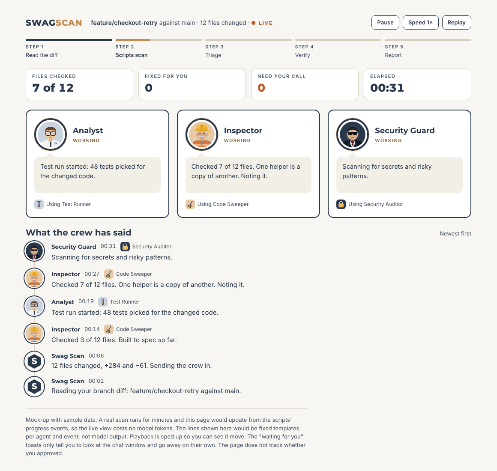

<p align="center">
  
</p>

# Swag Scan

**A pre-pull-request review for [Claude Code](https://claude.com/claude-code).** Three reviewers read your branch, only your change and never the whole repo, and hand back one short report of what needs your decision.

[](https://github.com/jswagger/swag-scan/actions/workflows/test.yml)


> **Beta.** Swag Scan is still being tested on real projects and is not at 1.0. Expect rough edges, and expect behavior to change between updates. Findings are leads for a human to judge, not verdicts, and the report never says your code is "clean". [Open an issue](https://github.com/jswagger/swag-scan/issues) if something looks wrong.

## See it work

<p align="center">
  
</p>

While a scan runs, a page opens in your browser showing the five steps, the counts, each reviewer's latest line and a newest-first timeline. Scripts build it from a local event log, so it costs no model tokens. *The image is an illustrative mock-up with sample data; it also shows a Test Runner tool that is still on the roadmap.*

When the scan finishes you get one decisions-first report:

- what needs your decision (🔴 Critical, 🟡 Feature gap or design issue, ✅ Cleanup),
- what was fixed,
- who looked at what, and the language coverage.

## The crew

<p align="center">
  
</p>

| Reviewer | Asks | Built on | Can edit files? |
| --- | --- | --- | --- |
| **Analyst** | Does it work, and did it break anything? | Bug Hunter | No |
| **Inspector** | Was it built properly, with no loose ends? | Code Sweeper | Only with auto-fix on |
| **Security Guard** | Is it safe to ship? | Security Auditor | No |

## Built to be trusted

- **No third-party code.** No `package.json`. Every import is a Node built-in, and the tests run on Node 22 and 24 with nothing installed.
- **No network from the scripts.** No `fetch`, no `http`, no URLs, no telemetry. The live view is one self-contained page that re-reads a local file.
- **A short, fixed list of commands.** Read-only `git` (`diff`, `merge-base`, `rev-parse`, `ls-files`, `grep`) run without a shell, plus the plugin's own scripts. Nothing commits, checks out, fetches or pushes.
- **Writes stay in `.swag-scan/`.** The first run changes no files in your repository. Only the Inspector can edit source, and only with auto-fix on.
- **The reviewers are on a leash.** A default-deny hook limits what they can run in Bash to the Swag Scan scripts, read-only git and read-only file commands.
- **Honest about the model.** The scripts send nothing anywhere. The reviewers are Claude Code subagents, so what they read is seen by the model your Claude Code session already uses.

Every command, read and write is listed in **[docs/TRANSPARENCY.md](docs/TRANSPARENCY.md)**, with a few one-line commands to check the claims yourself.

## Install

You need [Claude Code](https://claude.com/claude-code), Node 22 or 24, and git. There are no other dependencies.

```
/plugin marketplace add jswagger/swag-scan
/plugin install swag-scan@swag-scan
```

Restart Claude Code after installing. The plugin is versioned (see [CHANGELOG.md](CHANGELOG.md); below 1.0 while in beta) and each merged pull request raises the version, so `/plugin marketplace update swag-scan` (or the plugin manager's update) picks up the latest fixes.

## Quick start

Check out the branch you want reviewed (committed, and ahead of the branch it will merge into), start Claude Code **inside that repository**, and set up the config once:

```
/swag-scan:config
```

It asks five quick questions and saves the answers in `~/.swag-scan/settings.json`, so they apply to every repository. Then run a review with your ticket ID:

```
/swag-scan:run ID-123
```

Run `/swag-scan:run` before the config exists and it stops with "Please set up your config file first. Run /swag-scan:config to get started." The config holds:

- `ticketSourcePath`: the folder with your Jira XML exports. `ID-123` is read from `ID-123.xml` there. See [Ticket files](docs/REFERENCE.md#ticket-files).
- `targetBranch` (default `main`): the branch your changes are compared against.
- `liveDashboard` (default on): open the live view while a scan runs. See [Live view](docs/REFERENCE.md#live-view-dashboard).
- `autoFix` (default off): let the Inspector fix clear, low-risk cleanup items.
- `maxFileLines` (default `1000`): the Code Sweeper flags a changed file that is longer than this.

Optional extras after the ticket ID: `--agents analyst,security-guard` runs only some of the crew, and `--fresh` ignores earlier results for this commit and reviews again.

Scripts scan first (no model, no edits). The Analyst, Inspector and Security Guard then review in parallel, for the ones that have leads. A reviewer with no leads is skipped, and the report says "no leads", never "clean". Reports are saved to `.swag-scan/reports/<commit>/` as `report.md` and `report.html`. You can also ask for one reviewer by name, for example `@agent-swag-scan:security-guard`.

To cut permission prompts, add `Bash(swag-scan *)` to your allowed commands. Every run uses that one command shape.

## First run in a new repository

1. **Start Claude inside the repository you are reviewing** (`cd` first). The reviewers read `.swag-scan/run/summary.json` relative to where the session started, and their writes are limited to `.swag-scan/` there. Reviewing a second repository means a second session started in it.
2. **Check the target branch.** `targetBranch` in the config should be the branch this one will merge into, which is not always `main`. Change it any time with `/swag-scan:config`. Compare `git diff --stat <base>...HEAD` with what you expect. Swag Scan warns when another base makes the change much smaller, but only you know the real target.
3. **Keep the tool's folder out of `git status`** by adding `.swag-scan/` to `.git/info/exclude` (local only, nothing to commit).
4. **Look at the scan summary before the reviewers run.** It shows how many files came from the branch diff and how many are untracked. Untracked, non-ignored text files are scanned, so a local folder of data files can swamp the real change. If you see a warning, add that folder to `.git/info/exclude` and run again.
5. **Point to the ticket folder** with `ticketSourcePath` in the config (`/swag-scan:config` asks for it), if the work has a ticket. To get a ticket from Jira, open it, choose **Export**, then **Export XML**, and save the page with Ctrl+S (Cmd+S on Mac) as `ID-123.xml` in your ticket folder. For a ticket that spans several repositories, criteria that name another repository are listed as "Other repo, not scanned" and no finding is linked to them.

## More

| | |
| --- | --- |
| [docs/TRANSPARENCY.md](docs/TRANSPARENCY.md) | Every command, read and write, and how to verify them |
| [docs/REFERENCE.md](docs/REFERENCE.md) | Findings format, event log, rules, settings, ticket files, model roles, tests |
| [Windows and the VS Code extension](docs/REFERENCE.md#windows-and-the-vs-code-extension) | Finding `claude` when it is not on your PATH |
| [GitHub Copilot (experimental)](docs/REFERENCE.md#github-copilot-experimental-not-part-of-the-plugin) | The three skills only; the crew, report and live view are Claude Code only for now |

## Feedback

Swag Scan is in beta, so real-world reports are the most useful thing you can send: what you ran, what it found, what it got wrong, and any error text. [Open an issue](https://github.com/jswagger/swag-scan/issues).

## License

MIT
