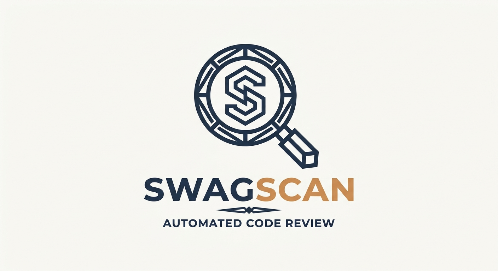

<p align="center">
  
</p>

# Swag Scan

Pre-PR review skills for coding agents. Three focused reviewers that check only your change, never the whole repo.

| Skill | Question it answers | Report |
| --- | --- | --- |
| [Bug Hunter](#bug-hunter) | What did this change break, and what new bugs did it add? | 🔴 Probable Bugs · 🟡 Suspicious · 🟢 Clean |
| [Code Sweeper](#code-sweeper) | Is this change clean, simple, and well tested? | 🔴 Unclean · 🟡 Dusty · 🟢 Clean |
| [Security Auditor](#security-auditor) | Does this change introduce vulnerabilities? | High Risk · Suspicious · Clean |

The skills don't overlap: Bug Hunter skips style and vulnerabilities, Code Sweeper skips bugs and security, and so on. Each one **collects** the diff, **scans** it with fast heuristics that flag *candidates*, then **reviews** each candidate in context. Matches are leads, not verdicts.

## Install

**Claude Code**

```
/plugin marketplace add jswagger/swag-scan
/plugin install swag-scan@swag-scan
```

**GitHub Copilot (VS Code)**

```bash
git clone --depth 1 https://github.com/jswagger/swag-scan.git && node swag-scan/scripts/install-copilot.mjs
```

Run it from your project root. Skills land in `.github/skills/`. Use `--target .agents/skills` for that folder instead, `--project DIR` to install elsewhere, and `--force` to overwrite an existing install.

## Use

```
/bug-hunter origin/main --ticket PROJ-123
/code-sweeper origin/main
/code-sweeper --no-fix          # review only, no edits
/security-auditor origin/main
```

In Claude Code, skills are namespaced: `/swag-scan:bug-hunter`. Leave off the base ref to use the configured default branch.

The scripts also run on their own. Scanners print candidates as JSON and never apply fixes:

```bash
node skills/review-tools-common/collect-diff.mjs \
  --config skills/code-sweeper/config.json origin/main \
  | node skills/code-sweeper/scripts/scan-patterns.mjs
```

Which diff is reviewed:

- No argument: the base is `origin/HEAD` (your default branch).
- A ref such as `origin/main` is compared from `git merge-base <ref> HEAD`, so target-only commits are excluded.
- `HEAD` compares only the working tree, which is often empty on a clean feature branch.
- Untracked, non-ignored text files are included. Binary and oversized files are skipped.

## Bug Hunter

A regression safety net. It looks for removed guards, dropped awaits, changed contracts, and broken callers, then checks the change against your ticket's acceptance criteria.

- **Rules:** `REMOVED_GUARD`, `REMOVED_AWAIT`, `REMOVED_ERROR_HANDLING`, `REMOVED_CLEANUP`, `MISSING_RELEASE`, `REMOVED_EARLY_EXIT`, `BEHAVIOR_CHANGE_PAIR`, `SIGNATURE_CHANGED`, `REMOVED_TEST_ASSERTION`, `TEST_DISABLED`.
- **Packets:** scripts rank findings by risk and bundle them with surrounding code and callers. Large diffs hit a size gate and ask whether to review everything or only the riskiest changes.
- **Languages:** JavaScript/TypeScript, C#, Python.
- **Reports:** saved to `.bug-hunter/reports`. Add `.bug-hunter/` to `.gitignore`.
- **Silence a finding:** `bug-hunter-ignore` or `bug-hunter-ignore: RULE_NAME` inline.

| Setting | Purpose | Default |
| --- | --- | --- |
| `autoFix` | Fix unambiguous 🔴 bugs. When `false`, no files are ever edited | `false` |
| `diff.maxDiffBytes` | Size gate for the diff | `102400` |
| `ticketContext` | Ticket file used as acceptance criteria (`--ticket <name>` overrides) | `null` |
| `repositoryContext` | Nearby docs for local patterns and invariants | `null` |
| `rules.disabled` / `rules.severityOverrides` | Tune noisy rules | none |
| `models.<agent>.basic` / `.advanced` | See [Model roles](#model-roles) | |
| `report.outputDir` | Where reports are written | `.bug-hunter/reports` |

## Code Sweeper

Checks changed code for long lines and functions, nested conditionals, heavy boolean logic, long comments, duplication, loose types, oversized files, and weak tests (`SWEEP-101` to `SWEEP-112`).

Auto-fix is on by default for clear, low-risk findings. Dusty findings are never auto-fixed, and test removal stays off until you set `tests.removeLowValue` in `config.json`.

| Setting | Purpose | Default |
| --- | --- | --- |
| `autoFix.enabled` | Fix clear, low-risk 🔴 findings (`--no-fix` overrides per run) | `true` |
| `tests.removeLowValue` | Allow removing low-value tests | `false` |
| `scan.exclude` / `scan.testFiles.patterns` | Files skipped, and paths treated as tests | see config |
| `scan.thresholds` | Review heuristics, not hard style rules | see config |

## Security Auditor

Scans JavaScript/TypeScript, Python, and C# by file, so language-specific heuristics only run on matching files. Coverage is heuristic, not exhaustive. A basic pass reviews common implementation risks (`CRIT-1xx`, `CRIT-2xx`), then an advanced pass looks at attack paths and architecture.

| Setting | Purpose | Default |
| --- | --- | --- |
| `models.<agent>.basic` / `.advanced` | See [Model roles](#model-roles) | |
| `scan.projectStack` | `backend`, `frontend`, `full-stack`, or `unknown` | `backend` |
| `scope.maxRelatedFiles` / `maxRelationshipHops` | How far review follows related code | `5` / `1` |

## Model roles

Bug Hunter and Security Auditor run two passes. `models.<agent>.basic` and `.advanced` pick a model for each pass on the agent you're using (`claude` or `copilot`). `null` or a missing entry uses the agent's default model, and without model-selectable subagents the agent does both passes itself.

| Agent | `basic` | `advanced` |
| --- | --- | --- |
| `claude` | `haiku` | `sonnet` |
| `copilot` | `null` | `null` |

## Tests

Requires Node 22+. No third-party dependencies.

```bash
node --test \
  "skills/bug-hunter/test/*.test.mjs" \
  "skills/code-sweeper/test/*.test.mjs" \
  "skills/security-auditor/test/*.test.mjs" \
  "skills/review-tools-common/test/*.test.mjs"
```

## License

MIT
