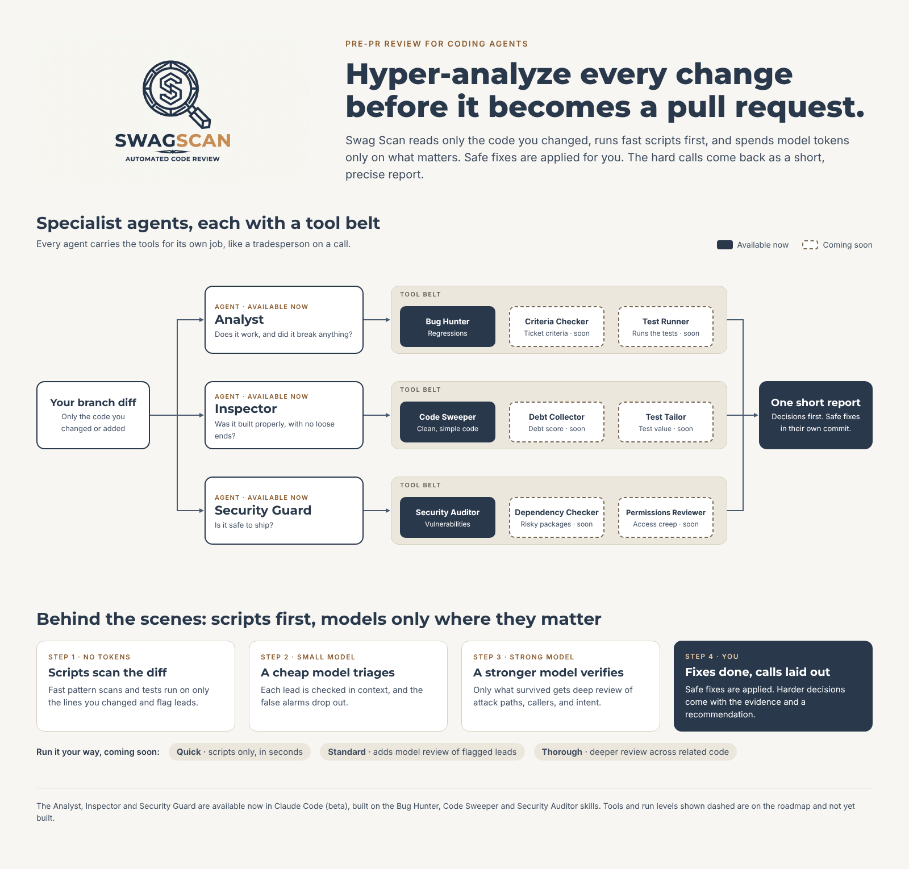
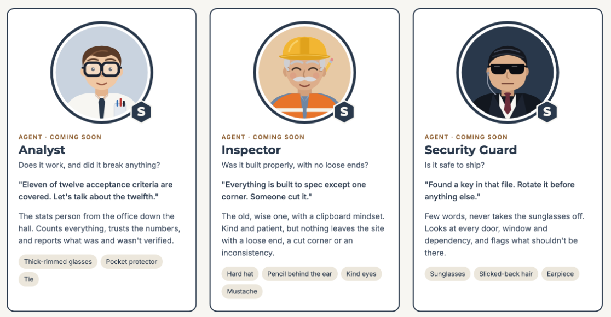

<p align="center">
  
</p>

# Swag Scan

**A pre-pull-request review for [Claude Code](https://claude.com/claude-code).** Three reviewers read your branch, only your change and never the whole repo, and hand back one short report of what needs your decision.

[](https://github.com/jswagger/swag-scan/actions/workflows/test.yml)


> **Beta.** Swag Scan is still being tested on real projects and is not at 1.0. Expect rough edges, and expect behavior to change between updates. Findings are leads for a human to judge, not verdicts, and the report never says your code is "clean". [Open an issue](https://github.com/jswagger/swag-scan/issues) if something looks wrong.

**Supported languages:** TypeScript, JavaScript, Python and C#. Files in any other language are listed as ⚪ Unchecked in the report, never as clean. A Dockerfile, Terraform, YAML, JSON and `appsettings.json` are not reviewed for bugs or configuration problems either. The Security Guard still scans every changed file for well-known secret formats, and reads build files (`package.json`, `requirements*.txt`, `pyproject.toml`, `.csproj`), GitHub workflow files, `.env` files and MCP config. If none of your changed files is in a supported language, the summary says so on its second line.

## See it work

<p align="center">
  
</p>

While a scan runs, a page opens in your browser showing the five steps, the counts, each reviewer's latest line and a newest-first timeline. Scripts build it from a local event log, so it costs no model tokens. *The image is an illustrative mock-up with sample data; it also shows a Test Runner tool that is still on the roadmap.*

When the scan finishes you get one decisions-first report:

- what needs your decision (🔴 Critical, 🟠 Feature gap or design issue, 🟡 Cleanup),
- what was fixed,
- who looked at what (with how many rules each reviewer applied), and the language coverage.

<details>
<summary><b>Sample report</b> (shortened, from a small demo change)</summary>

> **Swag Scan report: feature/PROJ-123 vs main**
>
> commit `a20d110` · no ticket
>
> **2 items need your decision** (2 critical, 0 design, 0 minor).
>
> **Next:** Start with AN-1: Input check and error handling removed.
>
> | # | Severity | Item |
> | --- | --- | --- |
> | AN-1 | 🔴 Critical | **Input check and error handling removed** · `src/users.js:1` · `REMOVED_GUARD` |
> | SG-1 | 🔴 Critical | **SQL built by string concatenation** · `src/users.js:4` · `SEC-101` |
>
> | Agent | Result |
> | --- | --- |
> | Analyst | Reviewed: 1 finding (1 critical, 0 design, 0 minor) from 4 leads. 10 rules applied. |
> | Inspector | No leads, so no model review. This is not a check that the code is sound. 11 rules applied. |
> | Security Guard | Reviewed: 1 finding (1 critical, 0 design, 0 minor) from 1 lead. 46 rules applied. |
>
> **SG-1 🔴 SQL built by string concatenation** · `src/users.js:4` · `SEC-101`
>
> **Evidence:** An id of "1 OR 1=1" returns every row in the users table.
>
> **Recommendation:** Pass id as a bound parameter, as the previous version did.

This is the report format, made by the report script from a demo repository. The findings in it were written by hand for the example, so it shows what a report looks like and not what Swag Scan will find in your code.

</details>

## The crew

<p align="center">
  
</p>

| Reviewer | Asks | Built on | Can edit files? |
| --- | --- | --- | --- |
| **Analyst** | Does it work, and did it break anything? | Bug Hunter | No |
| **Inspector** | Was it built properly, with no loose ends, and do its tests earn their place? | Code Sweeper and Test Tailor | Only with auto-fix on, and never a test |
| **Security Guard** | Is it safe to ship? | Security Auditor | No |

## Built to be trusted

- **No third-party code.** No `package.json`. Every import is a Node built-in, and the tests run on Node 22 and 24 with nothing installed.
- **No network from the scripts.** No `fetch`, no `http`, no URLs, no telemetry. The live view is one self-contained page that re-reads a local file.
- **A short, fixed list of commands.** Read-only `git` (`diff`, `merge-base`, `rev-parse`, `ls-files`, `grep`, `for-each-ref`, `check-ignore`) run without a shell, plus the plugin's own scripts. Nothing commits, checks out, fetches or pushes.
- **Writes stay in `.swag-scan/`, with one exception.** The first run adds `.swag-scan/` to your clone's own `.git/info/exclude` (local only, never committed) so the folder stays out of `git status`, and says so. It changes no files in your working tree. Only the Inspector can edit source, and only with auto-fix on.
- **The reviewers are on a leash.** A default-deny hook limits what they can run in Bash to the Swag Scan scripts, read-only git and read-only file commands.
- **Honest about the model.** The scripts send nothing anywhere. The reviewers are Claude Code subagents, so what they read is seen by the model your Claude Code session already uses.

Every command, read and write is listed in **[docs/TRANSPARENCY.md](docs/TRANSPARENCY.md)**, with a few one-line commands to check the claims yourself.

## Install

You need [Claude Code](https://claude.com/claude-code), Node 22 or 24, and git. There are no other dependencies.

```
/plugin marketplace add jswagger/swag-scan
/plugin install swag-scan@swag-scan
```

Restart Claude Code after installing. The plugin is versioned (see [CHANGELOG.md](CHANGELOG.md); below 1.0 while in beta) and each merged pull request raises the version, so `/plugin marketplace update swag-scan` (or the plugin manager's update) picks up the latest fixes.

## Quick start

Check out the branch you want reviewed (committed, and ahead of the branch it will merge into), start Claude Code **inside that repository**, and run:

```
/swag-scan:run
```

That is all the setup there is. With no config saved, Swag Scan uses the defaults: it detects the branch to compare against (`origin/HEAD`, `develop`, `main` or `master`, whichever exists), opens the live view and leaves auto-fix off, and the summary says so. A ticket is optional, so a run with no ticket is a normal run.

Scripts scan first (no model, no edits). The Analyst, Inspector and Security Guard then review in parallel, for the ones that have leads. A reviewer with no leads is skipped, and the report says "no leads", never "clean". Reports are saved to `.swag-scan/reports/<commit>/` as `report.md` and `report.html`. You can also ask for one reviewer by name, for example `@agent-swag-scan:security-guard`.

**With a ticket.** Add its ID, and the ticket's title, description and acceptance criteria are read as context for what the change is meant to do:

```
/swag-scan:run ID-123
```

Tickets are Jira XML exports only for now (no Word, Excel, CSV or other trackers). To get one, open the ticket in Jira, choose **Export**, then **Export XML**, save it as `ID-123.xml` in a folder, and give Swag Scan that folder in `/swag-scan:config`. For a ticket that spans several repositories, criteria that name another repository are listed as "Other repo, not scanned" and no finding is linked to them. See [Ticket files](docs/REFERENCE.md#ticket-files).

Optional extras after the ticket ID: `--agents analyst,security-guard` runs only some of the crew, and `--fresh` ignores earlier results for this commit and reviews again.

To cut permission prompts, add `Bash(swag-scan *)` to your allowed commands. Every run uses that one command shape.

### Change the defaults

```
/swag-scan:config
```

It asks a few quick questions and saves the answers in `~/.swag-scan/settings.json`, so they apply to every repository:

- `ticketSourcePath`: the folder with your Jira XML exports. `ID-123` is read from `ID-123.xml` there.
- `targetBranch` (default `auto`): the branch your changes are compared against. `auto` picks the first of `origin/HEAD`, `develop`, `test`, `main` and `master` that your branch grew from. Name a branch to fix it. If that branch does not exist, the run stops and lists the branches it found and which one it would suggest.
- `liveDashboard` (default on): open the live view while a scan runs. See [Live view](docs/REFERENCE.md#live-view-dashboard).
- `autoFix` (default off): let the Inspector fix clear, low-risk cleanup items.
- `maxFileLines` (default `1000`): the Code Sweeper flags a changed file that is longer than this.

One repository can use a different branch: `/swag-scan:config` asks whether a branch is for every repository or this one only, and `swag-scan config set targetBranch <branch> --this-repo` does the same from a shell.

### If something is wrong

`swag-scan doctor` checks Node (22 or 24), git, the repository, the branch to compare against, the ticket folder and whether `.swag-scan/` is ignored, and tells you the next step for anything that is not right. Errors from a run say what to do in a sentence, and a run stops before it starts if Node or git is missing.

## What a run costs

- **The scripts** (the first pass) use no model tokens. In our tests they take a second or two for a change of a few dozen files (35 files took about 1.2 seconds on a small cloud machine). They never edit anything.
- **The reviewers** are Claude Code subagents, so they use model tokens from your own Claude Code session, and take as long as a subagent takes. Only a reviewer with leads starts, and each reads just its leads and the code around them, never the whole repository. A change with no leads uses no model tokens at all.
- **Before the reviewers start**, the summary has a "Next:" line that names who will review and who is skipped. The "model tokens" figure that used to appear in the header only ever covered the script pass, so it is gone.
- Swag Scan never sees the reviewers' token counts, so it does not report them. Claude Code's own usage display shows what the session used.

## First run in a new repository

1. **Start Claude inside the repository you are reviewing** (`cd` first). The reviewers read `.swag-scan/run/summary.json` relative to where the session started, and their writes are limited to `.swag-scan/` there. Reviewing a second repository means a second session started in it.
2. **Check the branch it compared against.** The summary's first line names it, and says "(auto-detected)" when `targetBranch` is `auto`. It should be the branch this one will merge into, which is not always `main`. Compare `git diff --stat <base>...HEAD` with what you expect. Swag Scan warns when another base makes the change much smaller, but only you know the real target. Change it any time with `/swag-scan:config`.
3. **Nothing to do about `git status`.** The first run adds `.swag-scan/` to `.git/info/exclude` for you (local to your clone, nothing to commit) and tells you it did. If your `.gitignore` already ignores the folder, it leaves things alone.
4. **Look at the scan summary before the reviewers run.** It shows how many files came from the branch diff and how many are untracked. Untracked, non-ignored text files are scanned, so a local folder of data files can swamp the real change. If you see a warning, add that folder to `.git/info/exclude` and run again.

## More

| | |
| --- | --- |
| [docs/TRANSPARENCY.md](docs/TRANSPARENCY.md) | Every command, read and write, and how to verify them |
| [docs/REFERENCE.md](docs/REFERENCE.md) | Findings format, event log, rules, settings, ticket files, model roles, tests |
| [Windows and the VS Code extension](docs/REFERENCE.md#windows-and-the-vs-code-extension) | Finding `claude` when it is not on your PATH |
| [GitHub Copilot (experimental)](docs/REFERENCE.md#github-copilot-experimental-not-part-of-the-plugin) | The three skills only; the crew, report and live view are Claude Code only for now |

## Feedback

Swag Scan is in beta, so real-world reports are the most useful thing you can send: what you ran, what it found, what it got wrong, and any error text. [Open an issue](https://github.com/jswagger/swag-scan/issues).

## License

MIT
